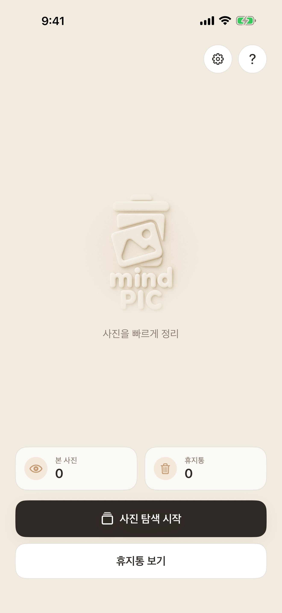
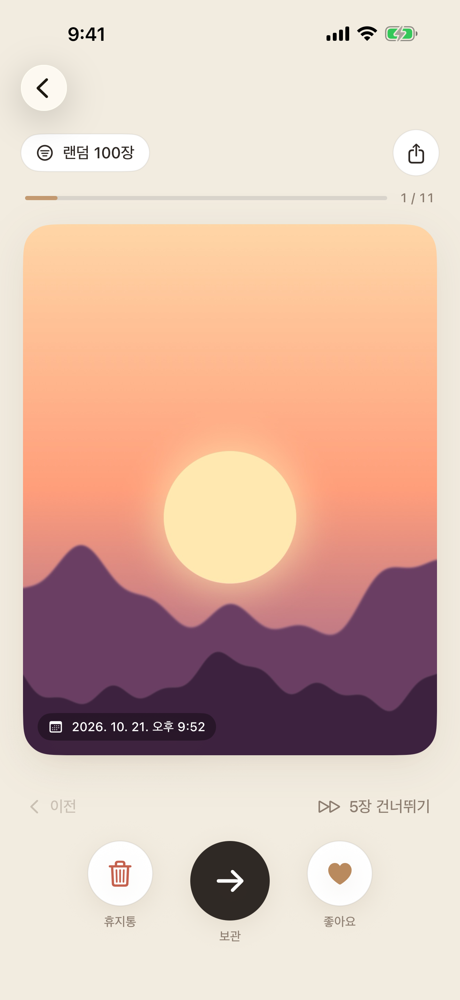
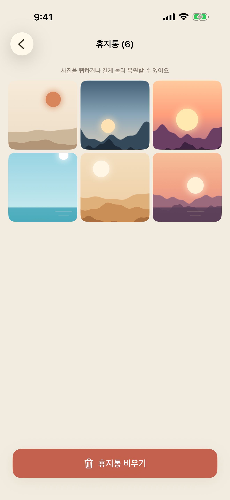
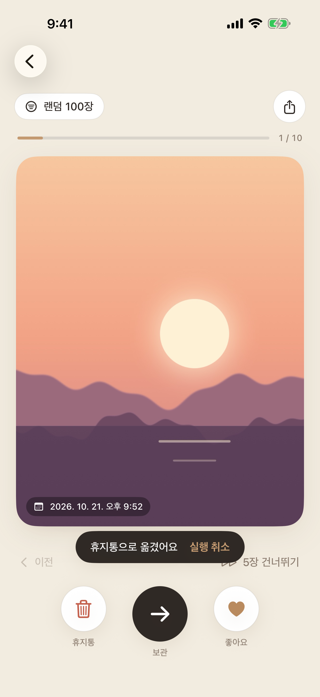
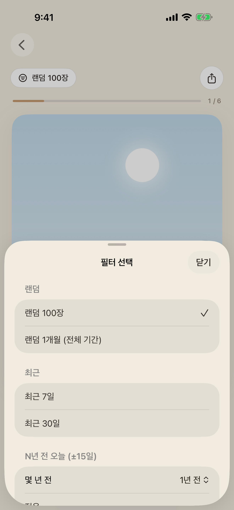
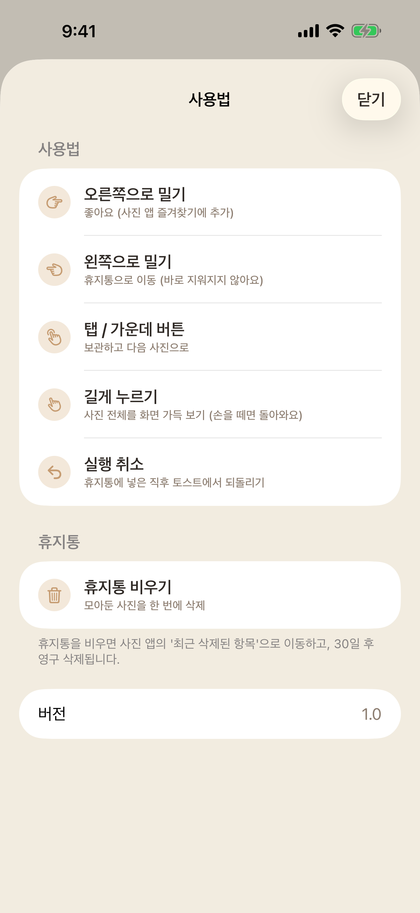
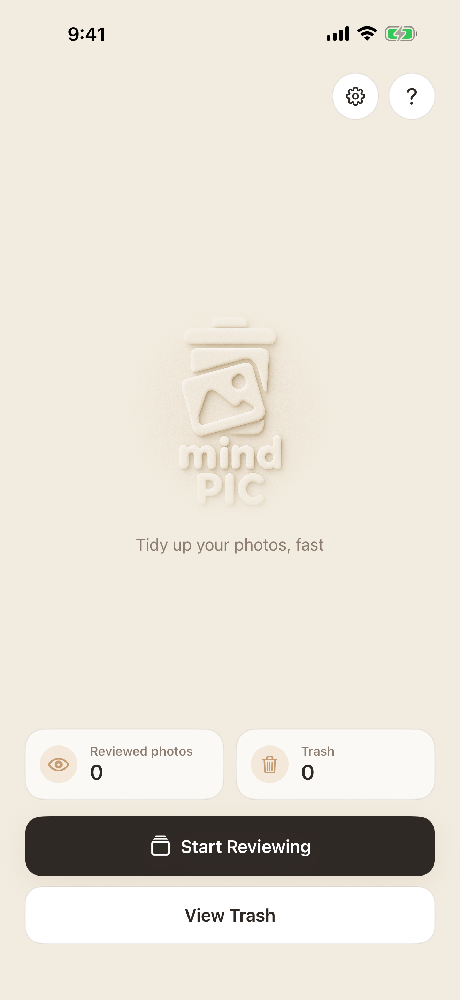
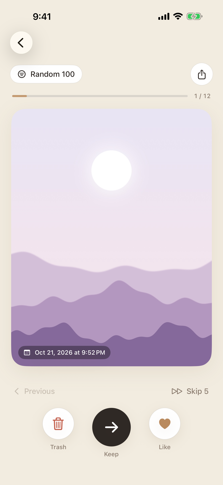
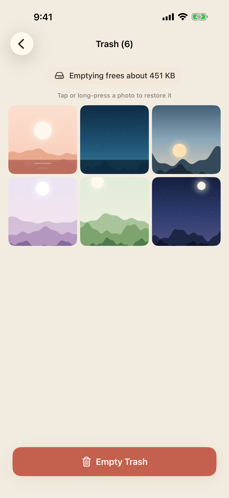

# mind PIC

**스와이프로 빠르게 끝내는 사진 정리 앱** (iOS)

사진첩에 쌓인 사진을 한 장씩 넘기면서 남길 사진과 지울 사진을 빠르게 고릅니다.
지운 사진은 바로 사라지지 않고 앱 휴지통에 모여서, 마지막에 한 번 더 확인할 수 있어요.

<p align="center">
  
  
  
</p>

## 한눈에 보기

| 동작 | 결과 |
|---|---|
| 👉 오른쪽으로 밀기 | **좋아요** — '사진' 앱 즐겨찾기에 추가 |
| 👈 왼쪽으로 밀기 | **휴지통** — 앱 휴지통으로 이동 (바로 실행 취소 가능) |
| 👆 탭 | **보관** — 그대로 두고 다음 사진으로 |
| ✋ 길게 누르기 | **전체 화면** — 사진 전체를 화면 가득 보기 (손을 떼면 돌아와요) |

스와이프가 어색하면 사진 아래 **휴지통 · 보관 · 좋아요** 버튼으로도 똑같이 할 수 있어요.

## 화면별 사용법

<table>
<tr>
<td width="260"></td>
<td>

### 1. 홈

- **사진 탐색 시작**을 누르면 바로 정리를 시작합니다.
- 사진첩 전체 중 **본 사진**이 몇 장인지(예: 6 / 11)와 **휴지통**에 모인 사진 수를 한눈에 볼 수 있어요.
- 휴지통을 비운 적이 있다면 **지금까지 확보한 공간**도 보여줘요.
- 오른쪽 위 ⚙️ **설정**에서 본 사진 기록을 초기화하거나 사진 접근 권한을 바꿀 수 있고, ❓ **사용법**에서 동작을 다시 확인할 수 있어요.

</td>
</tr>
<tr>
<td></td>
<td>

### 2. 넘기면서 정리하기

- 사진을 **좌우로 밀거나** 아래 버튼을 눌러 정리합니다. 미는 방향에 따라 "좋아요" / "휴지통" 표시가 점점 진해져요.
- 위쪽 **진행 막대**로 몇 장 남았는지 확인하고, 사진 왼쪽 아래에서 **찍은 날짜**를 볼 수 있어요.
- 이미 즐겨찾기에 있는 사진은 왼쪽 위에 **하트 배지**가 붙어요.
- 다음 사진이 카드 뒤에 미리 준비되어 있어서, 넘기는 순간 바로 선명하게 보여요.
- 카드는 화면에 맞게 사진을 잘라 보여줘요. 사진을 **길게 누르고 있으면** 잘린 부분 없이 전체 화면으로 볼 수 있고, 손을 떼면 돌아와요.
- **이전**으로 돌아가거나 **5장 건너뛰기**로 빠르게 넘길 수 있고, 오른쪽 위 버튼으로 사진을 **공유**할 수 있어요.

</td>
</tr>
<tr>
<td></td>
<td>

### 3. 실수해도 괜찮아요

- 휴지통으로 보낸 직후 아래에 **실행 취소**가 잠시 나타납니다. 누르면 사진이 원래 자리로 돌아와요.
- 놓쳤더라도 휴지통 화면에서 언제든 복원할 수 있어요.

</td>
</tr>
<tr>
<td></td>
<td>

### 4. 오늘은 어떤 사진을 정리할까요?

왼쪽 위 필터 버튼으로 정리할 사진을 고릅니다.

- **안 본 사진만 보기** — 한 번 넘긴 사진은 다시 나오지 않게 (필터 맨 위에 있어요)
- **랜덤 100장** — 부담 없이 조금씩 (기본)
- **랜덤 1개월** — 잊고 있던 한 달을 꺼내 보기
- **N년 전 오늘** (±15일) — 그날의 추억을 다시 보며 정리
- **최근 7일 / 30일**, **원하는 달 선택**
- **인물 사진**, **즐겨찾기 안 된 사진**, **스크린샷**, **연사**
- **기기에 있는 사진만 보기** — iCloud에서 받아야 하는 사진은 건너뛰어 기다림 없이 보기

</td>
</tr>
<tr>
<td></td>
<td>

### 5. 휴지통에서 마지막 확인

- 왼쪽으로 민 사진은 여기 모입니다. 아직 사진첩에서 지워지지 않았어요.
- 위쪽에 **비우면 확보할 수 있는 용량**이 표시돼요.
- 사진을 **탭하거나 길게 눌러 복원**할 수 있어요.
- **휴지통 비우기**를 누르면 시스템 확인 창이 뜨고, 확인하면 '사진' 앱의 **최근 삭제된 항목**으로 이동해 30일 동안 한 번 더 되살릴 수 있어요.
- 비우고 나면 **이번에 확보한 공간**과 **지금까지의 합계**를 보여줘요. (실제 공간은 '최근 삭제된 항목'을 비우거나 30일이 지나면 비워져요.)

</td>
</tr>
<tr>
<td></td>
<td>

### 6. 사용법

- 홈의 ❓ 버튼에서 스와이프 동작과 휴지통 규칙을 언제든 다시 볼 수 있어요.

</td>
</tr>
</table>

## 비슷한 사진 정리

홈의 **비슷한 사진**에서 연달아 찍은 비슷한 사진을 묶어 보여줍니다.

- 묶음마다 가장 잘 나온 사진에 **추천** 표시가 붙고, 처음에는 추천 사진만 남기도록 선택돼 있어요. 탭해서 남길 사진을 바꿀 수 있어요.
- **N장 휴지통으로** 한 번이면 묶음 정리 끝. 바로 **실행 취소**할 수 있고, 앱 휴지통을 거치니 실제 삭제 전에 다시 확인할 수 있어요.
- 추천 기준: 즐겨찾기한 사진 우선 → iOS 18 이상은 Apple의 사진 미적 점수, iOS 17은 얼굴 품질(얼굴이 있을 때)이나 선명도
- 기간은 최근 1개월 / 최근 1년 / 전체 중에서 고르고, 찾는 대로 바로 보여줘요.
- **모든 분석은 기기 안에서** Apple Vision 프레임워크로 처리합니다. 사진이 밖으로 나가지 않아요.

## 정리 추천

홈의 **정리 추천**에서 지울 만한 사진을 골라 보여줍니다. 즐겨찾기한 사진은 추천하지 않아요.

| 이유 | 기준 |
|---|---|
| 아쉬운 사진 | Apple의 사진 미적 점수가 낮음 (iOS 18 이상) |
| 흐림 | 윤곽선이 약함 — 흔들리거나 초점이 나감 (iOS 17) |
| 어두움 / 너무 밝음 | 평균 밝기가 아주 낮거나 높음 — 주머니 속, 실수로 찍힌 사진 |
| 기록용 | 영수증·문서·메모처럼 기록용으로 찍은 사진 (iOS 18 이상) |
| 스크린샷 | 스크린샷 |

- 추천된 사진은 처음부터 선택돼 있어요. 남길 사진만 탭해서 빼고 **N장 휴지통으로**를 누르면 끝. 바로 **실행 취소**할 수 있어요.
- 위쪽 칩으로 이유별로 걸러 볼 수 있고, 길게 누르면 크게 볼 수 있어요.
- 기준값은 `CleanupSuggestions.swift`의 `CleanupRules`에서 조정할 수 있어요.
- 비슷한 사진 정리와 마찬가지로 **모든 분석은 기기 안에서** 처리합니다.

## iCloud 사진도 빠르게

'iPhone 저장 공간 최적화'를 쓰면 원본이 iCloud에만 있는 사진이 많아서, 보통은 사진이 선명해질 때까지 기다려야 합니다. mind PIC은 이렇게 기다림을 줄여요.

- **기기에 있는 사진 먼저**: 앞으로 볼 사진 중 기기에 있는 사진을 앞으로 당겨 보여줍니다. 랜덤 100장에서는 iCloud에만 있는 사진을 기기에 있는 다른 사진으로 바꿔 넣어요.
- **미리 받아 두기**: 기기에 있는 사진을 보는 동안 iCloud 사진을 미리 받아 둡니다. 셀룰러·저데이터 모드·저전력 모드에서는 데이터와 배터리를 아끼려고 미리 받지 않아요.
- **진행률 표시**: 받는 중인 사진은 오른쪽 위에 진행률이 보이고, 실패하면 **다시 시도**할 수 있어요.
- **기기에 있는 사진만 보기**: 필터에서 켜면 iCloud 사진을 아예 건너뛰어요.

## 개인정보

- 회원가입·로그인 없음
- 광고, 분석·추적 도구 없음
- 모든 사진은 기기 안에서만 처리되며 어디에도 전송되지 않습니다 ([개인정보처리방침](docs/privacy-policy.md))

한국어 / 영어를 지원하고, Dynamic Type(큰 글씨)과 VoiceOver를 지원합니다.

---

## 개발

### 요구 사항

- iPhone, iOS 17.0 이상
- 개발: Xcode 16 이상

### 빌드

```bash
git clone https://github.com/minD3D/mindPic.git
open mindPic/mindPIC.xcodeproj
```

1. Xcode에서 **Signing & Capabilities > Team**을 본인 개발자 계정으로 설정합니다.
2. `mindPIC` 스킴으로 실행(⌘R), 테스트(⌘U)합니다.
3. 시뮬레이터에서는 사진 앱에 사진을 드래그해 넣어 테스트할 수 있습니다.

### App Store 스크린샷

```bash
scripts/take-screenshots.sh ~/Pictures/샘플사진   # 사진 폴더는 처음 한 번만
```

시뮬레이터(기본 iPhone 17 Pro Max, 6.9인치)에 사진 접근을 미리 허용하고 상태바를 정리한 뒤, 한국어/영어로 홈·리뷰·실행 취소·필터·휴지통·사용법 화면을 촬영해 `screenshots/`에 저장합니다. 제출용 최신본은 `docs/screenshots/`에 있습니다. (`DEVICE`, `LANGS`, `OUT_DIR` 환경 변수로 변경 가능)

### 로딩 성능 확인

실제 기기에서 사진이 선명해질 때까지 걸린 시간과 기기/iCloud 사진 수를 로그로 남깁니다. 아이폰을 Mac에 연결하고 **콘솔** 앱에서 기기를 선택한 뒤 `subsystem:mind3d.mindPIC`로 걸러 보세요.

### 구조

```
mindPIC/
├── MindPICApp.swift            앱 진입점
├── ContentView.swift           스플래시 → 홈
├── HomeView.swift              홈 화면 (본 사진 / 휴지통 수)
├── HomeSheets.swift            설정 / 사용법 시트
├── PhotoReviewView.swift       스와이프 리뷰 화면 (카드 스택), 필터 시트
├── PhotoReviewViewModel.swift  필터별 사진 조회(백그라운드), 이동/좋아요/삭제/실행 취소,
│                               기기 사진 우선 정렬, 프리히팅
├── TrashView.swift             휴지통 (복원, 비우기)
├── SimilarPhotosView.swift     비슷한 사진 묶음 화면
├── SimilarPhotosViewModel.swift 분석 진행, 남길 사진 선택, 정리 / 실행 취소
├── SimilarPhotos.swift         비슷한 사진 분석 (Vision 특징 벡터, 묶기, 추천 사진 점수)
├── CleanupSuggestionsView.swift 정리 추천 화면 (이유별 칩, 선택, 실행 취소)
├── CleanupSuggestionsViewModel.swift 분석 진행, 선택, 휴지통 이동 / 실행 취소
├── CleanupSuggestions.swift    정리 추천 이유 판단 규칙, 분석기
├── PhotoImageAnalysis.swift    사진 한 장 분석 (썸네일, 미적 점수, 얼굴 품질, 선명도, 밝기)
├── PhotoThumbnailView.swift    정사각형 썸네일 (휴지통, 비슷한 사진, 정리 추천)
├── AssetImageView.swift        미리보기 → 고해상도 로딩, iCloud 진행률 / 실패 처리
├── ReviewStateStore.swift      본 사진 / 휴지통 ID 저장 (UserDefaults)
├── PhotoModels.swift           PhotoItem, PhotoFilterType
├── PhotoHelpers.swift          권한 요청, 이미지 요청 스펙, 네트워크 상태, 로딩 로그
├── Theme.swift                 색상, 폰트, 공통 컴포넌트
├── Localizable.xcstrings       화면 문구 (ko, en)
├── InfoPlist.xcstrings         권한 안내 문구 (ko, en)
└── PrivacyInfo.xcprivacy       개인정보 매니페스트
```

- **UI**: SwiftUI
- **사진**: PhotoKit (`PHAsset`, `PHCachingImageManager`)
- **분석**: Vision (`VNGenerateImageFeaturePrintRequest`, `VNCalculateImageAestheticsScoresRequest`, `VNDetectFaceCaptureQualityRequest`), Core Image
- **테스트**: Swift Testing (`mindPICTests`), XCTest UI 테스트 (`mindPICUITests`)

### 출시

```bash
scripts/release.sh   # 단위 테스트 → Archive → App Store Connect 업로드
```

App Store Connect 입력값과 순서는 [출시 체크리스트](docs/release-checklist.md)에 정리되어 있습니다.

## 문서

- [출시 체크리스트](docs/release-checklist.md)
- [지원 / 자주 묻는 질문](docs/support.md)
- [개인정보처리방침](docs/privacy-policy.md)

## 문의

[GitHub Issues](https://github.com/minD3D/mindPic/issues)에 남겨 주세요.

---

# mind PIC (English)

**Swipe through your camera roll and clean it up fast.** Review your photos one at a time and decide what to keep and what to let go. Trashed photos aren't deleted right away — they wait in the in-app trash so you can check them one last time.

<p align="center">
  
  
  
</p>

| Gesture | Result |
|---|---|
| 👉 Swipe right | **Like** — adds to Favorites in the Photos app |
| 👈 Swipe left | **Trash** — moves to the in-app trash (undo right away) |
| 👆 Tap | **Keep** — leave it and see the next photo |
| ✋ Press and hold | **Full screen** — see the whole photo (release to go back) |

Prefer buttons? **Trash · Keep · Like** sit right below the photo.

- **Home**: see how many photos you've reviewed out of your whole library (e.g. 6 / 11), how many are in the trash, and how much space you've freed so far.
- **Review**: a progress bar shows how far you are, the capture date sits on the photo, and photos already in Favorites get a heart badge. The next photo waits behind the current card, so it's sharp the moment you swipe. Press and hold to see the whole, uncropped photo full screen.
- **Undo**: tap **Undo** right after trashing a photo, or restore it later from the trash.
- **Filters**: **Unseen Only** sits at the top, then Random 100, random month, on this day N years ago (±15 days), last 7/30 days, any month, portraits, not in Favorites, screenshots, bursts — plus **On-Device Photos Only**.
- **Trash**: see how much space emptying will free; tap or long-press to restore. **Empty Trash** moves photos to "Recently Deleted" in the Photos app (kept for 30 days) and shows how much you just freed.
- **Fast with iCloud Photos**: on-device photos are shown first and iCloud-only photos are downloaded ahead of time (not on cellular, Low Data, or Low Power mode), with a progress ring and Retry if a download fails.
- **Private by design**: no account, no ads, no analytics — everything stays on your device.
- Korean and English, Dynamic Type, VoiceOver. Requires iPhone with iOS 17.0+; built with SwiftUI and PhotoKit.

[Support & FAQ](docs/support.md#mind-pic-support-english) · [Privacy Policy](docs/privacy-policy.md#mind-pic-privacy-policy-english)
